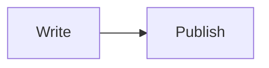

<p align="center">
  <a href="https://docleus.io"></a>
</p>

<h1 align="center">Mermaid Diagrams</h1>

<p align="center">
  <strong>Keep the diagram next to the words.</strong><br />
  Markdown fences, live editor previews, and browser-rendered diagrams.
</p>

<p align="center">
  <a href="LICENSE"></a>
  
  
  <a href="https://docleus.io"></a>
</p>

<p align="center">
  <a href="https://docleus.io">Documentation</a> &middot;
  <a href="#block">Write a diagram</a> &middot;
  <a href="https://github.com/Docleus/docleus">Run Docleus</a> &middot;
  <a href="https://github.com/Docleus/.github/blob/main/CONTRIBUTING.md">Contribute</a>
</p>

---

Mermaid diagrams in fenced code blocks, previewed in the editor and rendered in the browser on sites.

## Block

`mermaid.diagram` (version 1) stores the diagram text in `attrs.source`.

In Markdown it is a fenced code block with the info string `mermaid`:

````markdown

````

The codec claims `code:mermaid`. A fence with anything after `mermaid` in its info string (such as `mermaid title="x"`) stays a code block, so nothing in it is lost.

core-markdown asks codecs with a narrower claim such as `code:mermaid` before the one that claims `code`, so mermaid fences become diagrams whatever the plugin order is.

## Editor

Insert a diagram from the slash menu (`/mermaid`). Typing ` ```mermaid ` and a space also works, but only while this plugin's editor entry loads before commonmark's: commonmark's code-block shortcut matches the same text. The block has a source editor next to a live preview, rendered 300 ms after the last edit. Mermaid's parse and render errors show under the preview.

## Sites

The server renders the escaped source in `<pre class="mermaid-source">`, so pages without scripts and text-only readers still get the diagram text. The `mermaid.diagram` island replaces it with the SVG in the browser. On an error it keeps the source and shows the message below it.

Mermaid runs only in the browser entries (`dist/editor`, `dist/site`) and is loaded on first use from the plugin's own chunks. React and the SDK come from the host's import map. Server and shared code never import mermaid, and dependency-cruiser enforces this.

Diagrams render with `securityLevel: "strict"`, so mermaid sanitizes the SVG with DOMPurify and disables click handlers.

## Unsupported: ELK layout

`layout: elk` (and the `elk.*` layouts) are not supported. Mermaid lays them out with [elkjs](https://github.com/kieler/elkjs), which is licensed EPL-2.0, and Docleus ships only permissively licensed code. `pnpm-workspace.yaml` overrides `elkjs` with a stub in `stubs/elkjs/` that throws, so elkjs is never installed or bundled. A diagram that asks for ELK shows this error instead of rendering:

> The ELK layout is not supported: elkjs is EPL-2.0, which Docleus does not ship. Remove `layout: elk` to use the default layout.

Mermaid 12 defaults to the ELK layout, so this plugin sets the default to `dagre`.

## Licenses

The license check allows two more licenses than the other repositories, for mermaid's dependencies only:

- `Unlicense`, for `robust-predicates`.
- `dompurify` is `MPL-2.0 OR Apache-2.0`, and is used under Apache-2.0 (`license-clarifications.json`).

`khroma` is recorded as MIT in `license-clarifications.json`. Its package has no `license` field, so the checker guesses `MIT*` from its license file, which is the MIT License.

## Development

Use Node.js 24 and pnpm 11.21.0. Keep this repository next to `docleus-core`
with its original directory name; the `link:` development dependencies need
that layout. Install core before this repository:

```sh
pnpm --dir ../docleus-core install --frozen-lockfile
pnpm install --frozen-lockfile
pnpm check
pnpm build
```

`pnpm check` runs typecheck, lint, formatting, dependency boundaries, licenses,
and unit/in-process integration tests. Browser and external-service tests,
where provided, are separate and need the sibling repositories listed in
their setup files. The SDK is a host-provided peer dependency; packages remain
private and are not installed from npm. All extension points are experimental
before 1.0.

```sh
pnpm check   # typecheck, lint, format, dependency boundaries, licenses, unit tests
pnpm e2e     # Playwright: builds core, docleus-plugin-editor and docleus-plugin-blocks-commonmark first
```

## Community

[Contributing](https://github.com/Docleus/.github/blob/main/CONTRIBUTING.md) &middot;
[Code of conduct](https://github.com/Docleus/.github/blob/main/CODE_OF_CONDUCT.md) &middot;
[Security](https://github.com/Docleus/.github/blob/main/SECURITY.md) &middot;
[Support](https://github.com/Docleus/.github/blob/main/SUPPORT.md)

## License

[MIT](LICENSE)

## Compatibility

Version `0.0.6` supports Docleus core and SDK `0.0.1`, `0.0.2`, `0.0.3`, `0.0.4`, `0.0.5` and `0.0.6` through
the matching `>=0.0.1 <0.0.7` manifest and SDK peer ranges.
